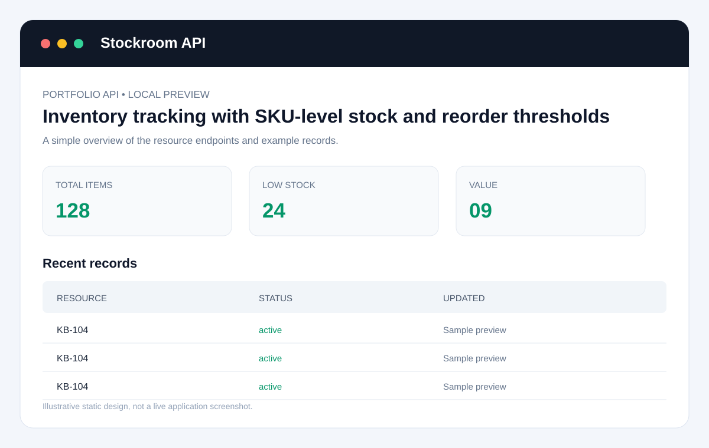

# Stockroom API

Inventory tracking with SKU-level stock and reorder thresholds.

> Portfolio demo by Hossam Elkady. Built with PHP 8.2+, Laravel 11, and SQLite for local development.



**Preview note:** the image is a static concept illustration for this API demo, not a screenshot of a running app. This repository focuses on the API; it does not claim a deployed service.

## What it demonstrates

- RESTful CRUD endpoints with JSON responses and pagination.
- Request validation and consistent error handling through Laravel.
- Resource-specific persistence, field validation, and test examples.
- Eloquent model, migration, and a focused feature-test suite.
- Lightweight local setup using SQLite.

## Data model

- `sku`: string unique
- `name`: string
- `quantity`: unsignedInteger default 0
- `reorder_level`: unsignedInteger default 5
- `unit_price`: decimal:10,2 default 0

## Requirements and setup

- PHP 8.2+
- Composer 2

```bash
cp .env.example .env
composer install
php artisan key:generate
touch database/database.sqlite
php artisan migrate
php artisan serve
```

The app runs at `http://127.0.0.1:8000`. The API is intentionally unauthenticated for a short portfolio sandbox.  All records are shared; there is no per-user data separation. Do not use it for real personal or customer data.

## API

| Method | Endpoint | Purpose |
|---|---|---|
| GET | `/api/health` | Health check |
| GET | `/api/items` | Paginated list (15 per page) |
| POST | `/api/items` | Create a record |
| GET | `/api/items/{id}` | Read one record |
| PUT/PATCH | `/api/items/{id}` | Update a record |
| DELETE | `/api/items/{id}` | Delete a record |

Example create request:

```bash
curl -X POST http://127.0.0.1:8000/api/items \
  -H 'Accept: application/json' -H 'Content-Type: application/json' \
  -d '{"sku": "KB-104", "name": "Wireless keyboard", "quantity": 18, "reorder_level": 6, "unit_price": "24.90"}'
```

## Tests

```bash
php artisan test
```

The feature tests cover the health check, create/list flow, and invalid input. PHP/Composer are not bundled; install dependencies locally before running tests.

## Design notes

- Form validation uses Laravel's JSON validation response (HTTP 422).
- IDs use implicit route model binding; missing records return 404.
- Paginated responses use Laravel's standard pagination envelope.
- The demo keeps domain scope small so the endpoints are easy to inspect.

## License

MIT. See [LICENSE](LICENSE).
